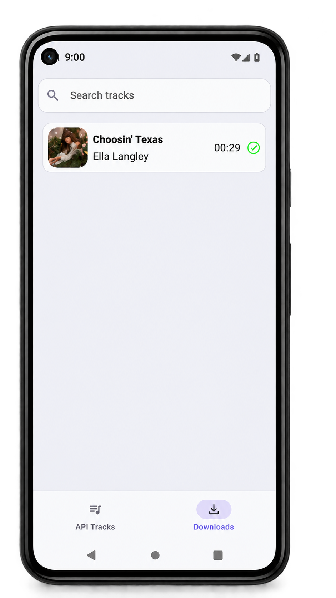
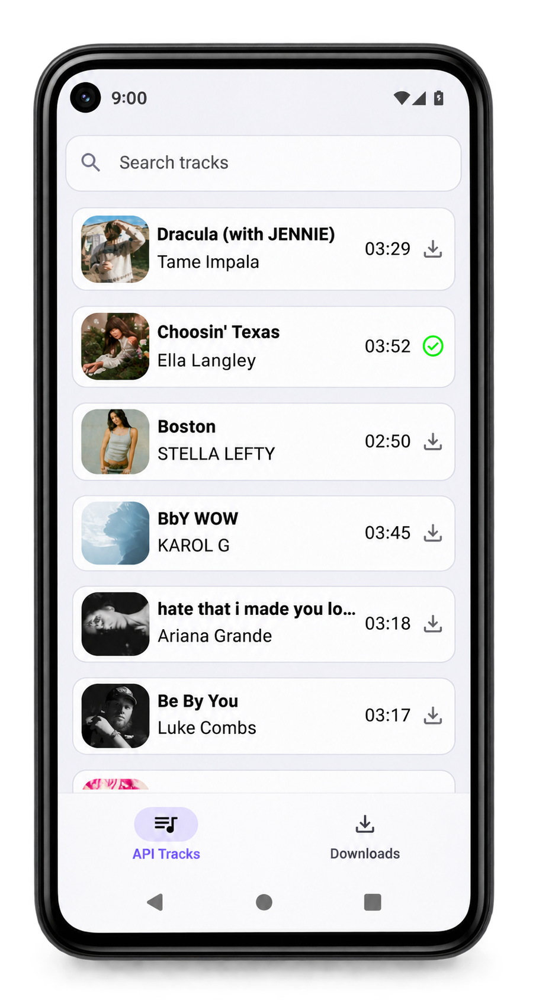
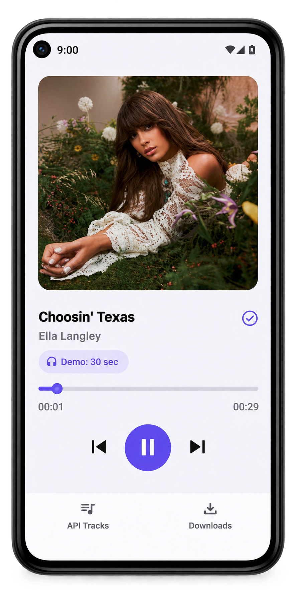
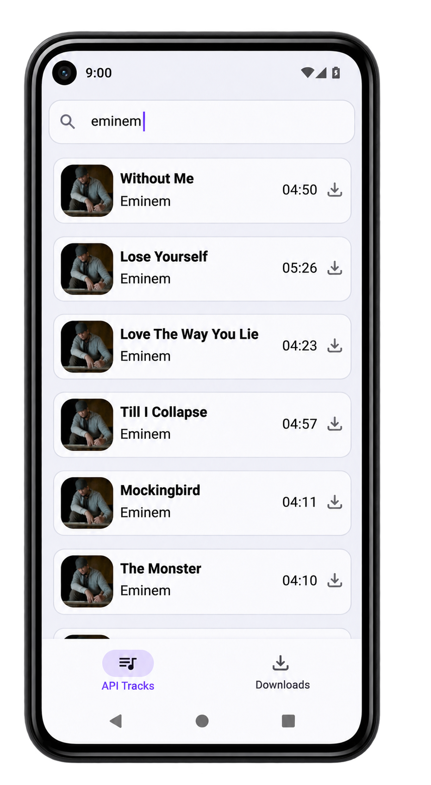
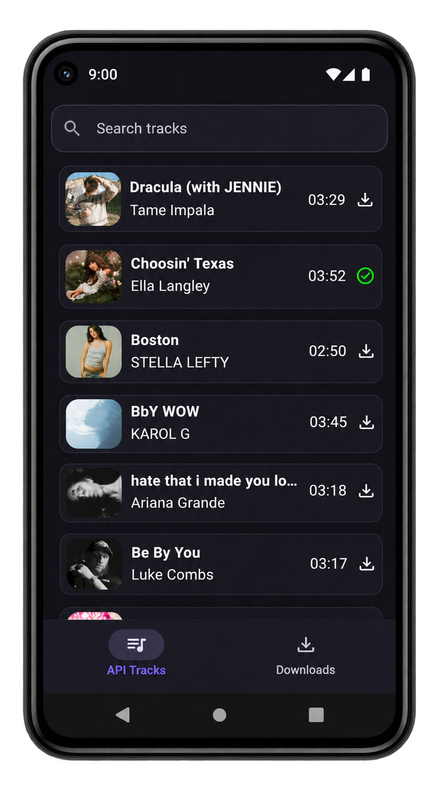
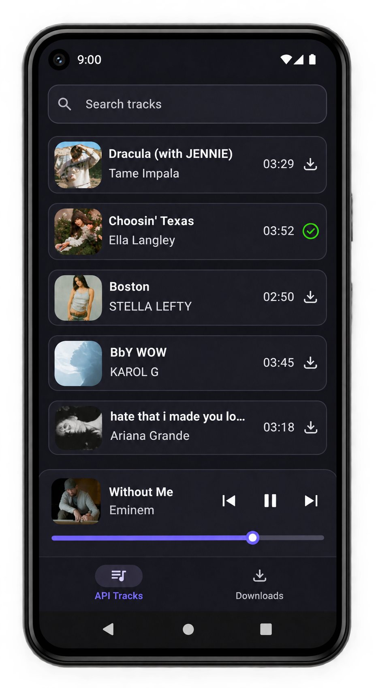

# Android Media3 Audio Player

**English** | [Русский](README.ru.md)

An Android app for browsing a device's audio library and listening to Deezer track previews.

> The online catalog uses available Deezer previews, not full tracks. Availability depends on the external service and an internet connection.

## Features

- Browse and search local audio using MediaStore; browse the Deezer chart and search its catalog.
- Play local audio and online previews, seek, and skip tracks.
- Full-screen player and mini-player; background playback with Media3 and a media session.
- Save available previews to the media library with metadata and, when available, artwork.
- Delete local audio with system confirmation when required.
- Light and dark themes following the system setting.

## Screenshots

| Local library | Online catalog | Player |
|:---:|:---:|:---:|
|  |  |  |

| Search | Dark theme | Mini-player |
|:---:|:---:|:---:|
|  |  |  |

## Tech stack

| Area | Technologies |
|---|---|
| Language and concurrency | Kotlin, Coroutines, Flow, StateFlow |
| UI | Jetpack Compose, Material 3, Navigation Compose, ViewModel |
| Playback | AndroidX Media3, ExoPlayer, MediaSession, MediaController |
| Device data | MediaStore, ContentResolver, Android permissions |
| Networking | Retrofit, OkHttp, Gson, Deezer API |
| Images | Coil |
| Dependency injection | Hilt, KSP |
| Build | Gradle Kotlin DSL, Version Catalog, Gradle Wrapper |
| Testing and diagnostics | JUnit, AndroidX Test, LeakCanary in debug builds |

## Architecture

The project combines layered architecture with a **feature-based** UI. Feature modules and data implementations use shared domain contracts; the app assembles the modules and owns root navigation.

```text
:app -> :feature:player, :feature:local_tracks, :feature:remote_tracks
:app -> :data, :domain, :core:ui, :core:designsystem
:feature:* -> :domain, :core:ui, :core:designsystem
:data -> :domain
:core:ui -> :domain, :core:designsystem
```

An arrow indicates a module dependency. Feature modules do not depend on `:data` or on each other.

| Module | Responsibility |
|---|---|
| `:app` | Application, Activity, navigation, app shell and dependency composition. |
| `:domain` | Kotlin/JVM models, repository and player contracts, and use cases. |
| `:data` | MediaStore and Deezer access, repository implementations, audio downloads and playback service. |
| `:core:designsystem` | Theme, color schemes and typography. |
| `:core:ui` | Shared app-specific Compose components and resources. |
| `:feature:local_tracks` | Local library screen and state. |
| `:feature:remote_tracks` | Online catalog and search screen and state. |
| `:feature:player` | Full-screen player and its state. |

### Playback and media library

`PlaybackService` creates an `ExoPlayer` and a `MediaSession` and releases them when the service is destroyed. The UI uses the domain `PlayerController` contract; its implementation communicates with the session through `MediaController`. Playback state is exposed through `StateFlow`.

The app reads local audio through MediaStore. Saving an online preview creates a local file with metadata; deletion uses system confirmation when required. File access depends on the Android version and granted permissions.

## Getting started

### Requirements

- Android Studio compatible with the configured Android Gradle Plugin and Gradle versions.
- JDK 17 to run Gradle; Java and Kotlin JVM target 17.
- Android SDK Platform API 37, installed through SDK Manager.
- A device or emulator running Android 8.0 / API 26 or later.
- Internet access for the online catalog, search, streaming and saving previews.

Gradle Wrapper specifies the Gradle version. Plugin and library versions are in `gradle/libs.versions.toml` and module build files.

1. Clone the repository and open its root directory in Android Studio.
2. Configure the Android SDK and JDK 17 for Gradle; wait for synchronization.
3. Select a device or emulator and run the `app` configuration.
4. Grant audio access when prompted. Add audio files to the device to try the local library.

No API key needs to be configured in the project; the Deezer base URL is defined in the network module.

Build from the terminal:

```bash
./gradlew :app:assembleDebug
```

On Windows use `.\gradlew.bat :app:assembleDebug`. The debug APK is generated in `app/build/outputs/apk/debug/`.

## Testing

The repository contains unit tests for domain logic, time formatting and MP3 metadata writing, and instrumented tests for MediaStore, deletion and the playback service lifecycle.

Example Windows commands (use `./gradlew` on macOS / Linux):

```powershell
.\gradlew.bat :domain:test :core:ui:testDebugUnitTest :data:testDebugUnitTest
.\gradlew.bat :app:connectedDebugAndroidTest
```

Instrumented tests require a connected device or emulator.

## Limitations and future work

- Reconnection of an existing controller after losing its session connection needs further work. The current test describes behavior after an artificially released controller, not every disconnect scenario.
- Complete test migration and recheck the main user flows.
- Build speed improvements from modularization have not been established by comparable measurements.

## Project status

An educational pet project developed incrementally, focused on Android multimedia APIs, local and remote data, and application architecture.
