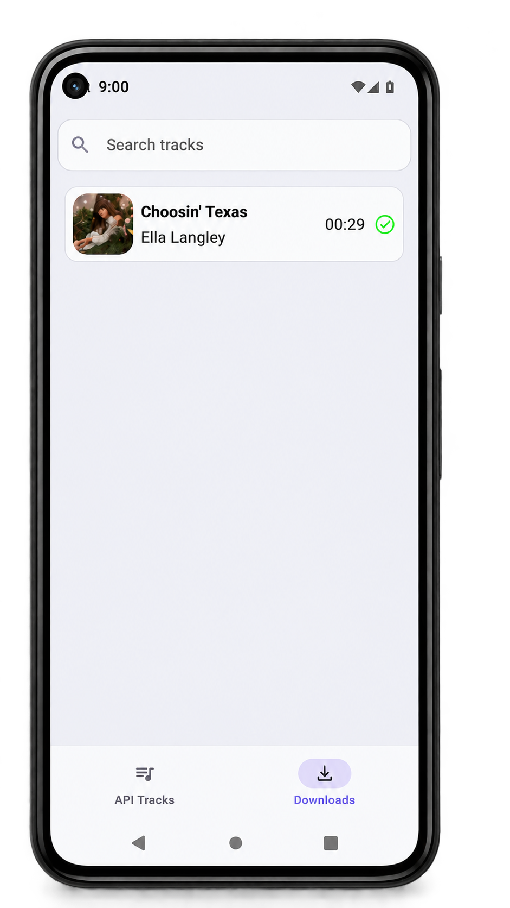
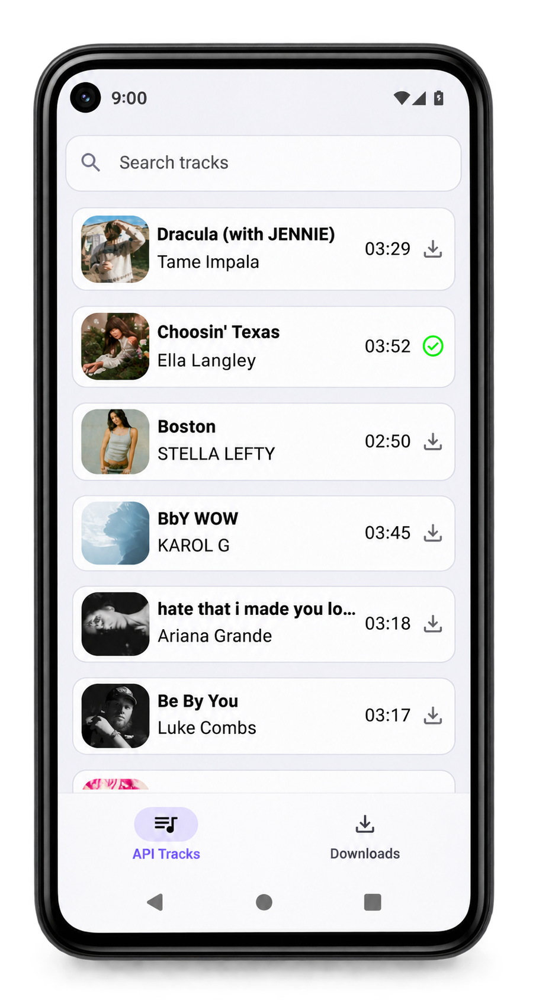
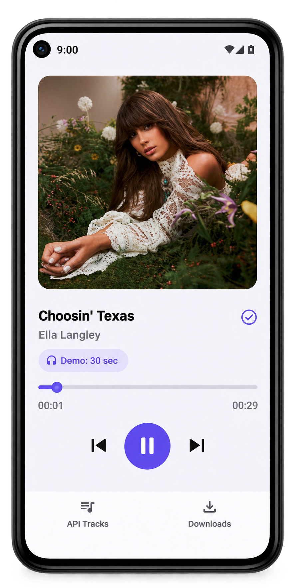
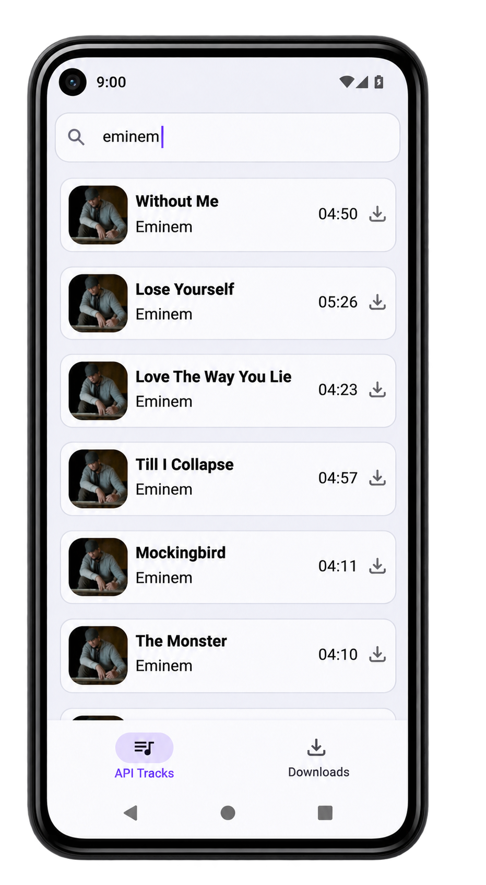
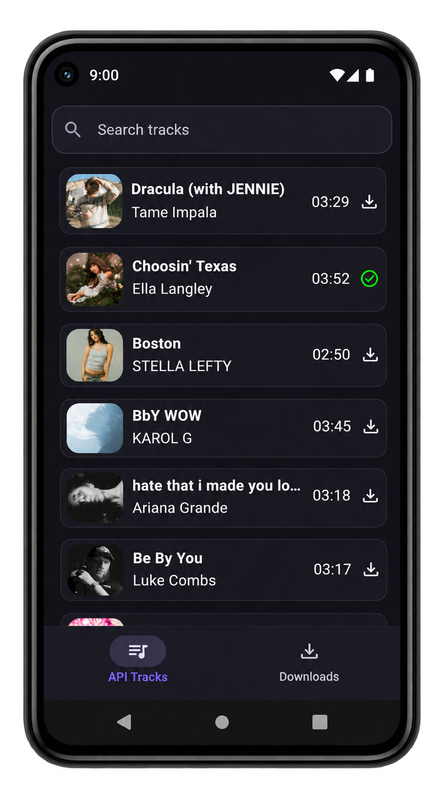
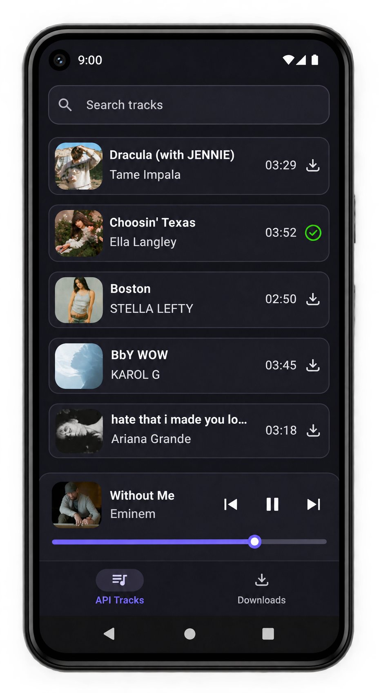

# Android Media3 Audio Player

[English](README.md) | **Русский**

Android-приложение для работы с аудиотекой устройства и прослушивания превью треков из Deezer.

> **Важно:** сетевой каталог использует доступные через Deezer API превью, а не полные версии
> композиций. Доступность каталога и аудиофайлов зависит от внешнего сервиса и подключения к
> интернету.

## Возможности

- Просмотр и поиск аудиофайлов устройства через MediaStore; просмотр чарта и поиск треков через
  Deezer API.
- Воспроизведение локальных аудиофайлов и сетевых превью, перемотка и переключение треков.
- Полноэкранный плеер и мини-плеер; фоновое воспроизведение с помощью Media3 и медиасессии.
- Сохранение доступного превью в медиатеку устройства с метаданными и, при наличии, обложкой.
- Удаление локального аудио с системным подтверждением, когда оно требуется Android.
- Светлая и тёмная темы в соответствии с системной настройкой.

## Скриншоты

|                        Локальная медиатека                         |                           Сетевой каталог                            |                         Плеер                          |
|:------------------------------------------------------------------:|:--------------------------------------------------------------------:|:------------------------------------------------------:|
|  |  |  |

|                                Поиск                                 |                            Тёмная тема                             |                           Мини-плеер                           |
|:--------------------------------------------------------------------:|:------------------------------------------------------------------:|:--------------------------------------------------------------:|
|  |  |  |

## Стек

| Область                    | Технологии                                                 |
|----------------------------|------------------------------------------------------------|
| Язык и асинхронность       | Kotlin, Coroutines, Flow, StateFlow                        |
| Интерфейс                  | Jetpack Compose, Material 3, Navigation Compose, ViewModel |
| Воспроизведение            | AndroidX Media3, ExoPlayer, MediaSession, MediaController  |
| Данные устройства          | MediaStore, ContentResolver, разрешения Android            |
| Сеть                       | Retrofit, OkHttp, Gson, Deezer API                         |
| Изображения                | Coil                                                       |
| Внедрение зависимостей     | Hilt, KSP                                                  |
| Сборка                     | Gradle Kotlin DSL, Version Catalog, Gradle Wrapper         |
| Тестирование и диагностика | JUnit, AndroidX Test, LeakCanary в debug-сборке            |

## Архитектура

Проект сочетает разделение по слоям с **feature-based** организацией UI. Feature-модули и реализации
данных используют общие доменные контракты; приложение связывает модули и содержит корневую
навигацию.

```text
:app -> :feature:player, :feature:local_tracks, :feature:remote_tracks
:app -> :data, :domain, :core:ui, :core:designsystem
:feature:* -> :domain, :core:ui, :core:designsystem
:data -> :domain
:core:ui -> :domain, :core:designsystem
```

Стрелка означает зависимость модуля от другого модуля. Feature-модули не зависят от `:data` и друг
от друга.

| Модуль                   | Ответственность                                                                              |
|--------------------------|----------------------------------------------------------------------------------------------|
| `:app`                   | Application, Activity, навигация, общий каркас и сборка зависимостей.                        |
| `:domain`                | Kotlin/JVM-модели, контракты репозиториев и плеера, use cases.                               |
| `:data`                  | Работа с MediaStore и Deezer API, реализации репозиториев, загрузка аудио и playback-сервис. |
| `:core:designsystem`     | Тема, цветовые схемы и типографика.                                                          |
| `:core:ui`               | Общие прикладные Compose-компоненты и ресурсы.                                               |
| `:feature:local_tracks`  | Экран и состояние локальной медиатеки.                                                       |
| `:feature:remote_tracks` | Экран и состояние сетевого каталога и поиска.                                                |
| `:feature:player`        | Экран и состояние полноэкранного плеера.                                                     |

### Воспроизведение и медиатека

`PlaybackService` создаёт `ExoPlayer` и `MediaSession` и освобождает их вместе с сервисом. UI
использует доменный контракт `PlayerController`; его реализация взаимодействует с сессией через
`MediaController`. Состояние воспроизведения доступно через `StateFlow`.

Приложение получает локальные записи через MediaStore. При сохранении сетевого превью формируется
локальный аудиофайл с метаданными; при удалении используется системное подтверждение, если оно
необходимо. Доступ к файлам зависит от версии Android и выданных разрешений.

## Запуск

### Требования

- Android Studio с поддержкой используемых версий Android Gradle Plugin и Gradle.
- JDK 17 для запуска Gradle; Java/Kotlin JVM target — 17.
- Android SDK Platform API 37, установленная через SDK Manager.
- Устройство или эмулятор с Android 8.0 / API 26 или новее.
- Интернет для сетевого каталога, поиска, потокового воспроизведения и сохранения превью.

Версия Gradle зафиксирована в Gradle Wrapper. Версии плагинов и библиотек находятся в
`gradle/libs.versions.toml` и build-файлах модулей.

1. Клонируйте репозиторий и откройте его корневую директорию в Android Studio.
2. Укажите Android SDK и JDK 17 для Gradle, дождитесь синхронизации.
3. Выберите устройство или запустите эмулятор, затем запустите конфигурацию `app`.
4. Разрешите доступ к аудиофайлам, когда приложение запросит его. Для проверки локальной медиатеки
   на устройстве должны быть аудиофайлы.

В проекте не требуется указывать API-ключ: базовый адрес Deezer задан в сетевом модуле.

Сборка из терминала:

```bash
./gradlew :app:assembleDebug
```

В Windows используйте `.\gradlew.bat :app:assembleDebug`. Debug APK создаётся в
`app/build/outputs/apk/debug/`.

## Тестирование

В проекте есть unit-тесты доменной логики, форматирования времени и записи MP3-метаданных, а также
instrumented-тесты для MediaStore, удаления и жизненного цикла playback-сервиса.

Примеры команд для Windows; на macOS / Linux замените `.\gradlew.bat` на `./gradlew`:

```powershell
.\gradlew.bat :domain:test :core:ui:testDebugUnitTest :data:testDebugUnitTest
.\gradlew.bat :app:connectedDebugAndroidTest
```

Для instrumented-тестов необходимо подключённое устройство или работающий эмулятор.

## Ограничения и дальнейшее развитие

- Переподключение существующего контроллера после потери соединения с сессией требует доработки.
  Текущий тест фиксирует поведение при искусственном освобождении контроллера, а не все возможные
  сценарии разрыва.
- Необходимо завершить перенос тестов и повторно проверить основные пользовательские сценарии.
- Ускорение сборки после модуляризации не подтверждено сопоставимыми измерениями.

## Статус проекта

Учебный pet-проект, который развивается поэтапно. Основной фокус — практическая работа с Android
multimedia API, локальными и сетевыми данными и архитектурой приложения.
